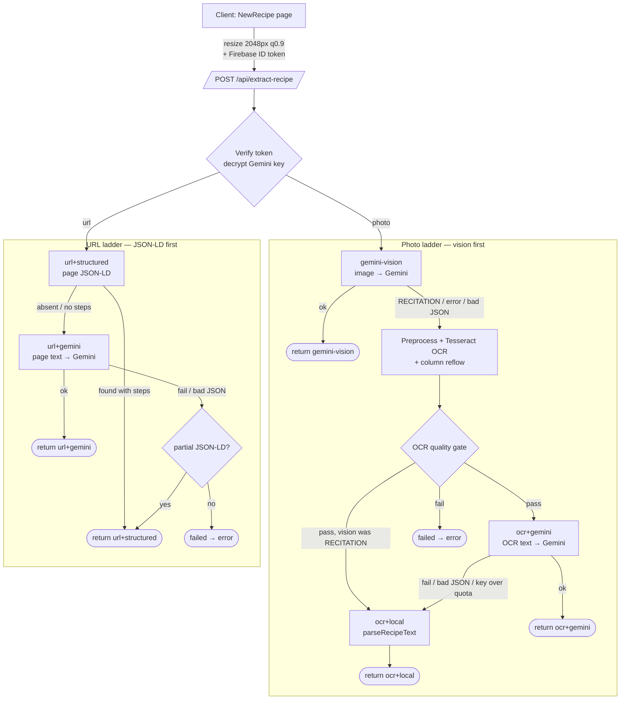

# Recipe Extraction Architecture

How a photo or URL becomes a structured recipe in Beckfield Bistro. This document
is the source of truth for the extraction pipeline — written for both humans
(overview, rationale) and AI agents working in the code (exact paths, shapes,
invariants, and where to change what).

> **TL;DR** — Photos try Gemini vision first, then fall back to OCR + Gemini, then
> a deterministic local parser. URLs try the page's own JSON‑LD structured data
> first, then Gemini. Every path has a deterministic fallback so a readable input
> almost always yields an editable recipe, and every outcome is counted so the
> method order can be revisited from real data.

---

## 1. Why this exists

The original implementation sent the photo straight to Gemini, which **transcribed
and structured in one step**. Transcribing a copyrighted cookbook page verbatim
trips Gemini's **RECITATION** safety filter (finish reason `RECITATION`), returning
a hard block instead of a recipe. Users hit this constantly on published cookbooks.

The pipeline is built around three principles:

1. **Accuracy to source.** Ingredient `originalText` and step wording must match the
   page. We prefer a deterministic transcription/structuring over a model that might
   paraphrase or drift.
2. **A deterministic fallback at every stage.** A readable input should always return
   a result the user can edit, even if every AI call fails or is blocked.
3. **Observability over guesswork.** Which method produced each result is recorded,
   so the ordering can be tuned from real fallback rates rather than assumption.

RECITATION fires on the **output** matching copyrighted text, so it correlates with
published cookbooks. **The block is respected, never routed around:** once Gemini
declines a recipe for RECITATION, no further Gemini call is made for that request.
Photos fall to OCR + the deterministic local parser (no model at all); URLs return
partial JSON‑LD if the page had it, else a 422 asking the user to enter it manually.
Do not add a path that hands blocked content back to Gemini in another form (e.g.
as OCR text) — that would circumvent the filter.

---

## 2. Components at a glance

| Layer | File | Responsibility |
|-------|------|----------------|
| Client wrapper | `src/lib/recipeExtraction.ts` | Resize image, attach auth token, POST to the API, surface errors |
| Client UI | `src/pages/NewRecipe/index.tsx` | Capture/crop/URL entry, call the wrapper, populate the editable form |
| API handler | `api/extract-recipe.ts` | Auth, key decryption, the full method ladders, analytics, response shaping |
| OCR module | `api/_utils/ocr.ts` | Image preprocessing, Tesseract engine, quality gate |
| Column reflow | `api/_utils/columnReflow.ts` | Rebuilds reading order of side‑by‑side columns from word boxes |
| Fraction recovery | `api/_utils/fractions.ts` | Finds misread fraction glyphs and decides what the re-read evidence adds up to |
| Parsers | `api/_utils/recipeParsers.ts` | Deterministic ingredient/step parsing, `parseRecipeText`, JSON‑LD helpers' dependencies |
| OCR line clean‑up | `api/_utils/ocrLines.ts` | Bullets, junk, nutrition boxes, unit misreads — line classification for `parseRecipeText` |
| Crypto | `api/_utils/crypto.ts` | AES‑256‑GCM decrypt of the per‑user Gemini key |
| Traineddata | `api/_tessdata/eng.traineddata.gz` | English Tesseract model, bundled into the function |
| Function config | `vercel.json` | `maxDuration: 60` and `includeFiles` for the Tesseract runtime |

There is **one** extraction endpoint: `/api/extract-recipe`. (A former
`/api/extract-recipe-url` endpoint was removed — its logic lives here now.)

---

## 3. End‑to‑end flow



Every terminal node calls `recordExtractionMethod(...)` before responding (including
the `failed` nodes).

---

## 4. Client contract

`src/lib/recipeExtraction.ts`

- **`extractRecipeFromImage(dataUrl, hasApiKey)`** → resizes with
  `resizeImage(dataUrl, { maxDimension: 2048, quality: 0.9 })`, then POSTs
  `{ base64, mediaType }`.
- **`extractRecipeFromUrl(url, hasApiKey)`** → POSTs `{ url }`.
- Both attach `Authorization: Bearer <Firebase ID token>` and throw
  `RecipeExtractionError(message)` on non‑2xx, using the server's `error` string.

`resizeImage(dataUrl, { maxDimension = 1568, quality = 0.85 })` is shared: the
**1568/0.85 default is for cover images** (stored as data URLs inside Firestore docs,
which have a 1 MiB cap) and **must not be raised globally**. Only the extraction call
uses 2048/0.9, which stays under the endpoint's 8 MB body limit.

---

## 5. Server: `api/extract-recipe.ts`

### 5.1 Preamble (both inputs)
1. `POST` only; verify the Firebase ID token → `uid`.
2. Read `users/{uid}/meta/profile.geminiApiKeyEncrypted` and decrypt it
   (`decryptSecret`, `API_KEY_ENCRYPTION_SECRET`). **Keys are per‑user and billed to
   the user — there is no shared server key.** Missing key → 400 asking them to add one.
3. Branch on `hasImage` (`base64` present) vs `hasUrl` (`url` present).

### 5.2 Photo ladder (vision first)
1. **`gemini-vision`** — `callGeminiWithRetry(imageParts, SYSTEM_PROMPT)` where
   `imageParts = [{ inlineData }, USER_PROMPT]`. Parseable JSON → return. A
   RECITATION block (or any error, or unparseable output) is caught into `visionError`
   and drops to OCR. The `forceOcr: true` body flag skips this step (debug/rollback).
2. **OCR** — `preprocessForOcr(buffer)` → `getOcrEngine().recognize(...)` →
   `assessOcrQuality(ocr)`.
   - **Gate passes:**
     - **`ocr+gemini`** — `callGeminiWithRetry([ocrUserPrompt(text)], OCR_SYSTEM_PROMPT)`,
       **skipped** when `visionError` was a rate‑limit (same key would fail again)
       or **RECITATION** (the block is respected — the same content is not handed
       back to Gemini as text). Parseable → return, with `ocrText` included.
     - **`ocr+local`** — `parseRecipeText(ocrText)` (deterministic) → return, with
       `ocrText` included. This is the only structuring path after RECITATION.
   - **Gate fails** → **`failed`**: if `visionError` exists, map it with
     `sendGeminiError`; otherwise 422 "try a clearer photo / enter manually".

### 5.3 URL ladder (JSON‑LD first)
1. Fetch the page (5 s timeout, must be `text/html`); derive `coverImage`
   (`extractPageImage`) and `pageText` (`stripHtml`, newline‑collapsing).
2. **`url+structured`** — `findJsonLdRecipe(html)` + `jsonLdToRecipe(ld, hostname)`.
   A `schema.org/Recipe` node (exact to source, free, RECITATION‑proof) → return —
   **but only when it actually carries a method.** A page that publishes a Recipe
   with ingredients but an empty/unreadable `recipeInstructions` would otherwise
   return a recipe with no steps ("missing method"), so that case **falls through
   to Gemini** to recover the method, keeping the partial structured recipe as a
   last‑resort return so the ingredients are never lost.
3. **`url+gemini`** — `callGeminiWithRetry([<page text prompt>])`. Parseable → return;
   thrown error → the salvaged partial JSON‑LD if there was one, else **`failed`**
   via `sendGeminiError`.
4. Unparseable / nothing usable → the salvaged partial JSON‑LD if there was one,
   else **`failed`** 422.

> Note: the URL local parser `parseRecipeText` is **not** used here because
> `stripHtml` collapses newlines and that parser is line‑based. JSON‑LD is the URL
> path's deterministic rung instead.

### 5.4 Shared Gemini retry — `callGeminiWithRetry(genAI, parts, systemInstruction?)`
- `PRIMARY = gemini-3.1-flash-lite`, `FALLBACK = gemini-3.5-flash`.
- Retries the primary on **503 overload** with backoff `[0, 1000, 2500] ms`; a **429
  rate‑limit** skips straight to the fallback model (separate quota bucket).
- **RECITATION and any other error are thrown to the caller.** RECITATION is never
  retried with Gemini in any form: photos → OCR + local parser; URLs → partial
  JSON‑LD or a clear 422. There is intentionally **no temperature‑1.3 recovery**.

### 5.5 Error classification & mapping
- `isRateLimitError` → 429, `isOverloadError` → 503, `isRecitationError` → 422,
  else → 502. Centralized in `sendGeminiError(res, err)`.

---

## 6. OCR module: `api/_utils/ocr.ts`

Behind the `OcrEngine` interface so a cloud OCR (e.g. Google Cloud Vision) can replace
Tesseract by adding one class and switching `getOcrEngine()` — callers never change.

```ts
interface OcrResult { text: string; rawText: string; confidence: number; columnsReflowed: boolean; fractionsRecovered?: number; coldWorker?: boolean }
interface OcrEngine { readonly name: string; recognize(image: Buffer): Promise<OcrResult> }
```

- **Worker lifecycle** — one Tesseract worker per warm serverless instance (wasm +
  traineddata init is expensive), with a promise‑chain mutex so concurrent invocations
  serialize onto the single worker. On worker error the worker is dropped and re‑init'd.
  Language `eng` from `api/_tessdata/eng.traineddata.gz` (bundled via `includeFiles`).
- **`preprocessForOcr(image)`** — sharp: EXIF `rotate()`, upscale small images toward
  ~300 dpi (cap ~2800/3000 px), grayscale, `normalize`, `sharpen`, PNG. No hard
  threshold (Tesseract's Otsu handles uneven lighting better). Optional
  `PreprocessOptions` (`targetLongest`, `normalize`, `sharpen`, `threshold`) exist only
  for comparing variants in the offline eval; production passes none.
- **`rawText`** — Tesseract's own text before column reflow. Production uses `text`;
  `rawText` lets the eval measure what the reflow adds.
- **Column reflow — `reflowColumns` in `api/_utils/columnReflow.ts` (the important
  part).** Recipe pages set ingredients, method and side notes in two to four
  side‑by‑side columns, and Tesseract often reads straight across them ("1 tbsp honey
  (or brown rice syrup Place the soy sauce…"). No text parser can untangle that, so the
  reflow rebuilds reading order from **word bounding boxes**:
  1. Wide inter‑word gaps are gutter candidates.
  2. Gutters are found as **density peaks** of where the next column starts — not by
     chaining nearby candidates, which a mangled column full of wide gaps would merge
     into one useless group. A gutter needs several rows, real text to its left (a
     gap after a bullet glyph is not a gutter), and a band where its rows are close
     together (gaps lining up by chance far apart do not make it live in between).
     A gutter crossed by words on most rows of its band is rejected.
  3. Each gutter is fitted as a sloped line (tilted photos). Lines are split where a
     wide gap sits on a live gutter — step numbers may hang a little left of their
     column — or, for columns set so tight that OCR fused them, at the first word
     past the edge.
  4. A narrow **sliver of the facing page** down the left edge ("bay", "ier", "tray")
     is lifted off each line and emitted last, so it cannot glue onto ingredients.
  5. Output: the heading block above the columns (title, subtitle, intro) in reading
     order, then each column top to bottom, left to right, then full‑width footers.
     A column that runs on below its neighbour stays in its column. No recurring
     gutter → `null`, Tesseract's text passes through. `columnsReflowed` records
     whether a reflow happened.
- **Fraction recovery — `recoverFractions` (in `ocr.ts`, logic in `fractions.ts`).**
  Tesseract almost never reads fraction glyphs on a photo: "1½" comes back as `1%`,
  "½" as `¥`, `Ya` or a plain `2`, "¼" as `V4`, "⅓" as `5`. Its confidence does not
  flag these (`1%` scores 96), so candidates are found by shape instead: an odd token
  (`%`, `¥`, `V4`, `Ya`…) at the start of a line, after bullets, or after "of", or a
  lone leading digit too wide to be a digit. Each glyph is cropped from the image
  (between the whole‑number digit and the next word, then trimmed to the ink),
  enlarged, and its top‑left and bottom‑right quarters are read as single digits.
  `resolveFraction` accepts only a kitchen fraction (½ ⅓ ⅔ ¼ ¾ ⅛) read from the image,
  ½ from a lone denominator of 2, or an unambiguous misread (`V4` → ¼) that the image
  does not contradict. **Anything else leaves the OCR text unchanged** — `1%` is ½ or
  ¼, so it is never guessed. Corrections go into `text`; `rawText` stays Tesseract's
  own. The worker's page settings are restored after the pass. Adds well under a
  second per photo.
- **Quality gate — `assessOcrQuality`.** All must hold: text ≥ **150** chars,
  confidence ≥ **60**, alpha ratio (`[A-Za-z]` / non‑whitespace) ≥ **0.55**, non‑empty
  lines ≥ **6**. Failing any one routes the photo back to `gemini-vision` (or `failed`).

---

## 7. Parsers: `api/_utils/recipeParsers.ts`

Deterministic, model‑free. Shared by the OCR fallback and (via their dependencies) the
JSON‑LD path.

- `parseIngredientLine(line)` — splits quantity / unit / name; handles fractions and
  unicode (½, ⅓…). Preserves the full line as `originalText`.
- `buildIngredientSections(lines)` / `looksLikeSectionHeader(line)` — group ingredients
  under sub‑headers ("For the curry"). A heading must show **positive** evidence:
  trailing `:` or `/`, a `For the …` / `To serve` prefix, or a bare component word
  ("Dressing"). The **absence of a quantity is deliberately not a signal** —
  unquantified ingredients ("Thai chillies, to taste", "Salt") are ordinary, and
  treating them as headings shattered flat ingredient lists into bogus sections.
  Both callers (the JSON‑LD path and `parseRecipeText`'s sub‑header filter) share
  this one predicate so they cannot drift.
- `flattenInstructions(value)` — normalizes a `schema.org` `recipeInstructions`
  value into an ordered step list. Handles every shape real sites use: a single
  `Text` string (split on block separators — a bare string is **not** walked
  character‑by‑character), an array of strings, and nested
  `HowToStep`/`HowToSection`/`ItemList` (or untyped) wrappers, stripping any HTML
  tags/entities embedded in step text.
- `parseIsoDuration(iso)` — `PT15M` → "15 mins".
- `parseRecipeText(ocrText)` — the OCR last‑resort structurer. Lines are first cleaned
  by `api/_utils/ocrLines.ts`: bullet glyphs Tesseract reads as `#`, `@`, `©`, `¢` are
  stripped (and flag the line as an ingredient), a mid‑line bullet splits two fused
  ingredient columns, junk lines, nutrition boxes and page numbers are dropped (after
  servings and times are read), and unit misreads (`thsp`, `1tbsp`) are fixed. Then:
  - INGREDIENTS/METHOD headers are used when present. Otherwise the ingredients are
    **runs** of amount‑led or bulleted lines, with section headers and up to two
    wrapped lines each; a stray single amount line cannot stretch the block.
  - The method is the stretches of prose (two lines at least) after the ingredients
    start, outside ingredient runs — a second ingredient column can follow the method
    in reflowed text. Magazine numbering ("2 Add the…", or short with a cooking verb)
    starts a step; unnumbered methods split into paragraphs where a line ends a
    sentence well short of the column width, else into sentences.
  - The title is the first capitals line above the ingredients (joined with its
    wrapped line or a "with …" subtitle), skipping labels, pull‑quotes and lines
    opening in lower case.

JSON‑LD helpers live in `api/extract-recipe.ts`: `findJsonLdRecipe(html)` (scans
`application/ld+json`, handles `@graph` and array `@type`) and `jsonLdToRecipe(ld,
source)` (→ response shape, or `null` if it has neither ingredients nor steps).

---

## 8. Response shape

All success responses share this shape (extra fields are additive and backward‑compatible):

```jsonc
{
  "title": "string",
  "source": "string",              // cookbook/site, or 'Photo Upload'
  "servings": 4,
  "prepTime": "15 mins",           // or ''
  "totalTime": "40 mins",          // or ''
  "ingredientSections": [
    { "title": "For the curry",    // '' when a single unlabelled group
      "ingredients": [
        { "name": "rapeseed oil", "quantity": 3, "unit": "tbsp",
          "originalText": "3 tbsp rapeseed oil" }
      ] }
  ],
  "ingredients": [ /* flattened convenience copy of all sections */ ],
  "steps": ["string", "…"],
  "extractionMethod": "gemini-vision",   // see §9
  "ocrText": "…",                        // photo OCR paths only (≤ 15k chars)
  "coverImage": "https://…"              // URL paths only, when found
}
```

The client's `RecipeForm` lifts only named fields, so adding response fields never
persists anything unexpected to Firestore.

---

## 9. Extraction methods & analytics

`extractionMethod` (and the `recordExtractionMethod` counter key) is one of:

| Method | Input | Meaning | Gemini sees the image? |
|--------|-------|---------|------------------------|
| `gemini-vision` | photo | Gemini transcribed + structured the image | **yes** |
| `ocr+gemini` | photo | Tesseract transcribed; Gemini structured the **text** (never after RECITATION) | no |
| `ocr+local` | photo | Tesseract transcribed; `parseRecipeText` structured it | no (no Gemini) |
| `url+structured` | url | Page's own JSON‑LD recipe data | no |
| `url+gemini` | url | Gemini structured the page text | no |
| `failed` | either | No path produced a recipe | — |

**Tracking** — `recordExtractionMethod(method)` (best‑effort; never fails the request):
- logs `extract-recipe: extractionMethod=<method>`;
- increments Firestore counters at `analytics/extractionStats` (lifetime) and
  `analytics/extractionStats-YYYY-MM-DD` (daily), each holding
  `{ counts: { <method>: n, … }, fallbackReasons: { <step>-<reason>: n, … }, total }`.

**Fallback reasons** — `recordExtractionMethod(method, fallbackReasons)` also counts
why each Gemini step that was tried didn't produce the recipe, keyed
`<step>-<reason>`:

| Step | Reasons |
|------|---------|
| `vision` | `recitation`, `rate-limit`, `overload`, `error`, `bad-json`, `forced` (`forceOcr`) |
| `ocrGemini` | `recitation`, `rate-limit`, `overload`, `error`, `bad-json` |
| `urlGemini` | `recitation`, `rate-limit`, `overload`, `error`, `bad-json` |

One request can add several (e.g. `vision-overload` then `ocrGemini-bad-json` →
`ocr+local`). `vision-recitation` counts the cookbook photos Gemini declined;
those always end in `ocr+local` or `failed`. The `<method>` counts are unaffected.
Counters before this was added have no `fallbackReasons`.

**Timing** — every request that gets past sign-in ends at one `finish()` call in
`api/extract-recipe.ts`, which does both of the following:
- logs exactly one line, `extract-recipe: timing kind=photo|url method=<method> total=<ms>`
  followed by the stages that ran (`auth`, `profile`, `vision`, `ocrPreprocess`, `ocr`,
  `ocrGemini`, `local`, `analytics`), `ocrWorker=cold|warm` after `ocr`, and
  `<vision|ocrGemini>Model` / `Attempts`. The line is built from an allow-list in
  `api/_utils/extractionTiming.ts`: no uid, key, image, OCR text or model output.
- adds the total (measured up to the analytics write) to `durations.<method>.<bucket>` in both
  analytics docs, buckets `lt5s`, `5to10s`, `10to20s`, `20to40s`, `40sPlus`. Photo requests where
  OCR ran also add to `ocrCold` or `ocrWarm`. Percentiles read from the daily docs are approximate
  (bucket-sized), which is enough to choose between speed-ups. Vercel runtime logs expire after
  1 hour here, so the buckets are the baseline that lasts.

The client prints `extract timing: …` with `console.debug` only (resize, request, and total from
crop confirm to draft); nothing is sent anywhere. A dropped connection on photo or URL
extraction shows "Connection lost while reading the recipe…", not an API-key message.

**Reading the signal.** A rising `ocr+*` share means vision is being blocked/failing a
lot on photos; a high `url+gemini` share means few sites carried usable JSON‑LD. Either
is grounds to revisit method order (both are localized changes in the handler).

---

## 10. Configuration

Environment variables (names only):
- `VITE_FIREBASE_*` — client Firebase config.
- `FIREBASE_SERVICE_ACCOUNT` — server admin JSON for token verification.
- `API_KEY_ENCRYPTION_SECRET` — base64 32‑byte AES‑256‑GCM key for the per‑user Gemini keys.
- Per‑user Gemini keys live encrypted in Firestore; there is no shared `GEMINI_API_KEY`
  in production (`test-*.ts` smoke scripts use one locally).

`vercel.json` — `api/extract-recipe.ts` has `maxDuration: 60` and an `includeFiles`
glob that ships the traineddata + Tesseract wasm core + worker script, which nft can't
trace through Tesseract's dynamic `require`. **Removing that glob breaks OCR at runtime.**

---

## 11. Testing & debugging

- **`test-ocr.ts`** (`npx tsx test-ocr.ts [fixtures/.jpg]`) — offline: preprocess →
  OCR → `columnsReflowed` → gate → `parseRecipeText`; optionally runs the Gemini
  structuring if `GEMINI_API_KEY` is set. Fixtures in `fixtures/`:
  `recipe-print.jpg` (clean single column), `recipe-twocol.jpg` and `recipe-real.jpg`
  (two‑column, exercise the reflow), `recipe-hard.jpg` (should fail the gate).
- **`test-parsers.ts`** (`npx tsx test-parsers.ts`) — offline unit checks for the
  deterministic parsers, concentrated on ingredient‑section splitting (heading vs.
  unquantified ingredient). No network, key, or fixtures; exits non‑zero on failure.
- **`forceOcr: true`** in the request body skips vision — use it to exercise/verify the
  OCR path directly.
- **Server logs** carry `extractionMethod=…`, `ocr confidence=… chars=…
  columnsReflowed=…`, and gate‑fail reasons.
- **Response fields** `extractionMethod` and `ocrText` tell you which path ran and what
  the OCR actually read.
- Tesseract bundling can only be fully verified on a **Vercel preview deploy** — a local
  pass does not prove `includeFiles` is correct.

### 11.1 OCR-only accuracy eval

Measures how accurate the free path (Tesseract + `parseRecipeText`, i.e. `ocr+local`) is,
with no Gemini. Code: `scripts/eval-ocr.ts` (runner), `scripts/ocr-eval/` (pure scorer,
corpus format, report rendering, with Vitest tests).

**Corpus format.** A directory with `<id>.jpg`, `<id>.truth.json` (the recipe as it
should be, plus `extractionMethod` and `editedBeforeSave`) and `manifest.csv` with
columns `id, layout, handChecked, extractionMethod, editedBeforeSave`. `fixtures/`
holds a committed corpus of the 4 test photos with hand-written truth, so anyone can run
the eval end to end:

```bash
npm run eval:ocr -- --corpus fixtures
```

It writes `eval-out/report.md`, `report.json` and a self-contained `report.html`
(per-photo detail: thumbnail, gate, truth vs parsed ingredients and steps, raw and
reflowed OCR text). Options: `--out <dir>`, `--limit <n>`, and preprocessing variants
`--target <px>`, `--threshold <0-255>`, `--no-normalize`, `--no-sharpen`.

**Exporting the owner's photos (human only).** Agents never run this: it reads
Firestore with the service account.

1. `FIREBASE_SERVICE_ACCOUNT='…' node scripts/export-ocr-corpus.mjs --uid <your uid>`
   is a dry run that prints counts. Add `--apply` to write to `corpus/` (`--out` to
   change). It reads `bistros/{uid}/recipes` and `users/{uid}/recipes` and keeps
   recipes with `importMeta.method === 'photo'` and a JPEG `originalImage`. Recipes saved
   before `importMeta` existed have none; those count as photo imports when they have an
   `originalImage`, which the app only stores for photo imports (their edited status is
   unknown). Only
   recipes you created (`userId` is your uid) are exported: other bistro members'
   recipes are skipped and counted.
2. `corpus/` and `eval-out/` are gitignored. They hold your own recipes: keep them on
   your machine and never commit them.
3. Re-exporting keeps existing truth files and manifest tags (`--overwrite` replaces
   truth files).

**Hand-checking about 10 photos.** The saved recipe is only an approximation of the
truth: it may have come from Gemini, and you may have edited it. For a trustworthy
headline:

1. Pick about 10 photos across layouts (single column, two column, card, handwritten…).
2. Open `<id>.jpg` beside `<id>.truth.json`. Make the title, servings, each ingredient's
   `originalText`, `quantity` and `unit`, and the steps match the photo exactly.
   Steps are compared without their numbering.
3. In `manifest.csv`, set `layout` to a short tag and `handChecked` to `true`.
4. Run `npm run eval:ocr -- --corpus corpus`.

**Reading the report.** Headline numbers come from the hand-checked subset (the full
set if none is marked) at the parser stage. Every metric is also broken down by
layout tag, stage, edited vs unedited, and hand-checked vs full set.

- Stages: **raw** (Tesseract text before reflow), **reflow** (after `reflowColumns`),
  **parser** (`parseRecipeText` output). Text stages only measure whether the truth is
  present in reading order (ingredient recall, step CER, title), so the gap between
  reflow and parser is what the parser loses.
- Metrics: quantity+unit exact (of matched ingredients), ingredient recall and
  precision (fuzzy `originalText`, ≥80% similar), step character error rate, step
  count match, title (≥80% similar), servings (exact), "≤2 edits" (the user could reach
  the truth with at most two field edits) and gate pass rate.
- Gate failures are scored too, although production would not run `ocr+local` on them.
- Exported photos are the saved `originalImage` (1200px, JPEG q0.72); production OCRs
  the 2048px q0.9 upload. Scores are therefore a **lower bound**.

---

## 12. Known failure modes (watch these)

- **Silent OCR character errors.** Tesseract can be confidently wrong (`0/O`, `1/l`,
  `5/S`), corrupting quantities without failing the gate. The most insidious accuracy
  risk. Fraction glyphs are re‑read from the image (§6), but only when the evidence is
  clear: a `%` whose glyph will not read stays wrong, and a fraction misread as an
  ordinary‑width digit (`4 tsp` for "½ tsp") is not detected at all.
- **Reflow false positive.** A tabular ingredient list (amounts aligned in one column,
  names in another) can look like two columns and get split, divorcing quantities from
  names.
- **Reflow miss (`columnsReflowed=false` when it should be true).** Heavy page curvature,
  columns closer than the min‑gutter (~2.5% of page width) on most rows, or tilt beyond
  ~11°.
- **Parser heuristics are tuned on few photos.** The OCR fallback parser and reflow were
  tuned against the owner's 15‑photo corpus (§11.1) and guarded by invented test cases.
  Add a synthetic test for any new layout rather than tuning to one photo.
- **Gate too strict / lenient.** Number‑dense recipes can dip below the 0.55 alpha ratio
  (false reject → routed to vision); non‑recipe pages that are merely readable pass and
  get structured into nonsense.

See git history / the PR discussion for the reasoning behind each threshold.

---

## 13. Extending the pipeline (recipes for common changes)

- **Swap the OCR engine** → add a class implementing `OcrEngine` in `api/_utils/ocr.ts`
  and return it from `getOcrEngine()`. Nothing else changes.
- **Add an OCR language** → drop `<lang>.traineddata.gz` into `api/_tessdata/`, ensure
  it's in the `includeFiles` glob, and change the `createWorker('eng', …)` language.
- **Reorder methods** → the ladders are linear blocks in `api/extract-recipe.ts`
  (§5.2 / §5.3). Reordering is moving a block; keep a `recordExtractionMethod` call on
  every terminal branch.
- **Add a new method / metric** → call `recordExtractionMethod('<name>')` before the
  response; it auto‑creates the Firestore counter. Set `extractionMethod` on the payload.
- **Tune OCR thresholds** → constants at the top of `assessOcrQuality` and the reflow
  detection in `reflowColumns` (`api/_utils/columnReflow.ts`). Re‑run `test-ocr.ts` against all
  fixtures after any change.

---

## 14. Invariants (do not break)

1. **Every readable input returns something editable.** Do not remove a deterministic
   fallback rung without a replacement.
2. **Cover‑image resize stays at 1568/0.85.** Larger images overflow the Firestore 1 MiB
   doc limit; only the extraction upload uses 2048/0.9.
3. **`includeFiles` in `vercel.json` must cover the traineddata + Tesseract runtime**, or
   OCR throws `MODULE_NOT_FOUND` at runtime (build still passes — verify on a preview).
4. **Gemini keys are per‑user and server‑side only.** Never accept a key from the client
   or introduce a shared production key.
5. **`originalText` and step wording are verbatim.** Prompts forbid paraphrasing; the
   deterministic paths copy source text. Keep it that way — accuracy to source is the
   product requirement.
6. **Keep a `recordExtractionMethod` call on every terminal branch**, including failures,
   or the analytics denominator drifts.
